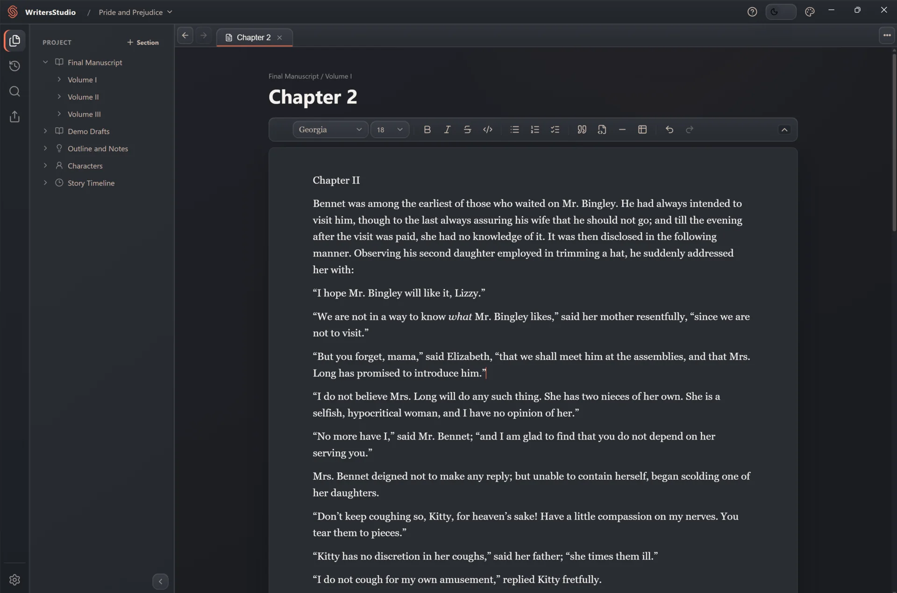
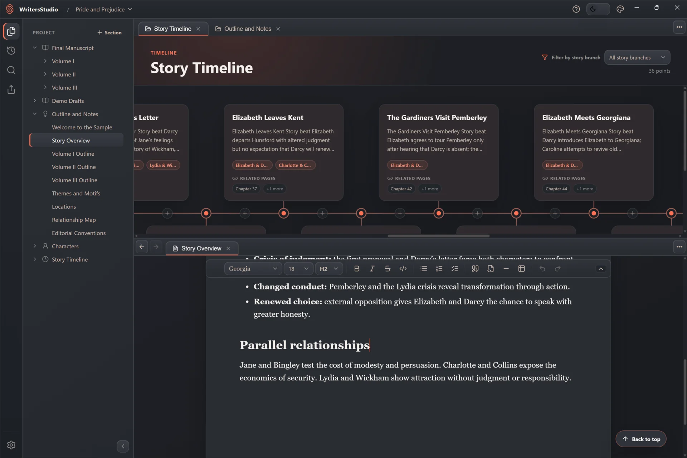
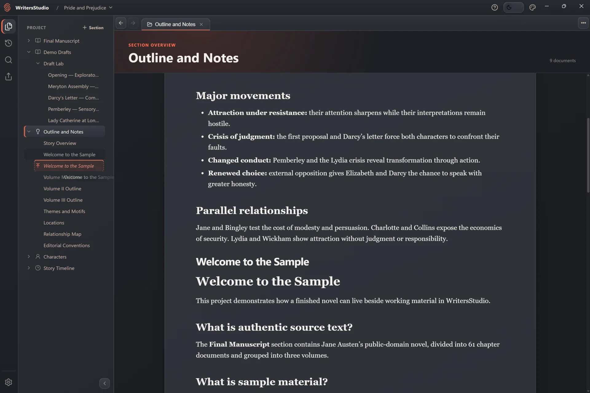
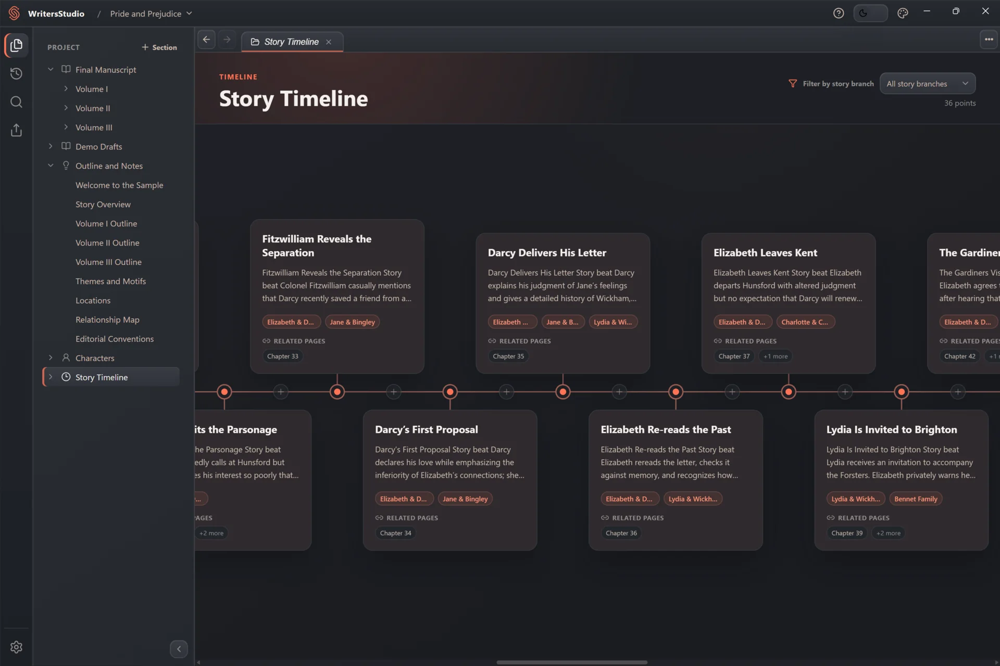
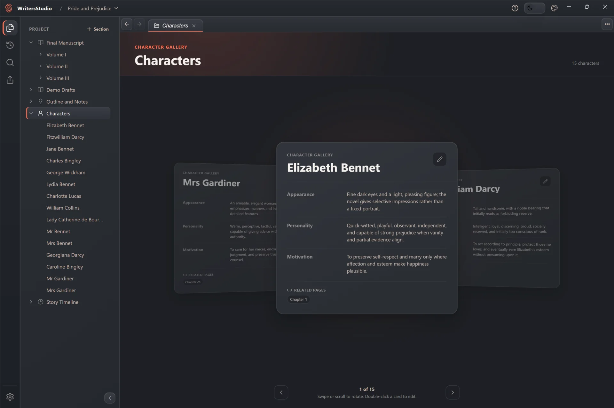

# WritersStudio

### Build the world. Shape the story. Keep every word yours.

A calm, local-first desktop studio for novels and long-form fiction.

**[Download the latest release](../../releases/latest)** · [View all releases](../../releases) · [Share feedback](../../issues/new)

  

## One place for the entire story

WritersStudio brings your manuscript, structure, characters, timeline, notes, and revision history into one focused workspace. It gives a large story room to grow without turning the writing process into project management.

| Write naturally                                                                                      | Organize without friction                                                                                                    |
| ---------------------------------------------------------------------------------------------------- | ---------------------------------------------------------------------------------------------------------------------------- |
| **Visual Markdown editor** Format prose directly—without writing markup by hand.                  | **Flexible project tree** Arrange chapters, scenes, notes, and custom sections around your process.                       |
| **Tabs and split views** Keep a scene beside its notes, character, or timeline while you write.   | **Project-wide search and replace** Find text across the whole project, with case-sensitive and regular-expression modes. |
| **Character profiles** Build reusable profiles with custom fields and links to related documents. | **Visual timeline** See events in story order and filter them by narrative thread.                                        |

<strong>See more of the workspace</strong>

 

  

  

## Rewrite without fear

WritersStudio keeps a local History for every new project. Create named save points, browse earlier versions, preview the past without disturbing the current draft, and explore a different direction on a new story branch.

Git provides the foundation under the hood; WritersStudio presents it as a writing tool. No command line, account, remote repository, or network connection is required.

<!--
SCREENSHOT 2 — HISTORY
Place one focused History screenshot here.
Suggested file: assets/screenshots/writersstudio-history.webp
Recommended crop: approximately 3:2, 1400–1800 px wide.
Show: several clearly named save points, two visible story branches, and the preview/details area.
Keep the graph readable; five to eight points are more persuasive than a dense stress-test history.
Suggested setup: copy the included sample outside this repository, enable History, and create a short alternate revision branch from one Demo Draft.

After adding the file, remove the comment markers around this block:

  

-->

## Your manuscript stays yours

WritersStudio is local-first by design:

- Your projects live in folders you choose on your own computer.
- Manuscript content is stored in portable Markdown and structured project files.
- Writing, editing, search, export, and History work offline.
- No account is required to create or open a project.
- Production builds currently have product analytics disabled.
- Updating or uninstalling WritersStudio does not remove your project folders.

Export selected sections to **DOCX** for further editing or **PDF** for sharing and review. You can also create a portable ZIP copy of a project whenever you want an independent backup.

> [!IMPORTANT]
> Local History protects your revisions, but it is not a replacement for a backup on another drive or service. Keep an independent copy of work you cannot afford to lose—especially while WritersStudio is in beta.

## See the story beyond the page

Open a character beside the manuscript, trace events across the visual timeline, or keep notes next to the scene that needs them. The workspace adapts to the way you think instead of forcing every part of a novel into one document.

<table>
  <tr>
    <td width="50%" align="center">
      
    </td>
    <td width="50%" align="center">
      
    </td>
  </tr>
  <tr>
    <td align="center">Trace events, story branches, and related manuscript pages.</td>
    <td align="center">Keep character details, motivations, and relationships close at hand.</td>
  </tr>
</table>

## Explore a complete sample project

The repository includes a ready-to-open WritersStudio edition of Jane Austen's
_Pride and Prejudice_: the complete 61-chapter novel in three volumes, plus
modern demo drafts, outlines, 15 character profiles, and a 36-event story
timeline with relationship threads and links back to the manuscript.

**[Browse the Pride and Prejudice sample](./samples/pride-and-prejudice/)**

The novel is public domain. Supplemental planning material was created for
this sample and is clearly separated from Austen's text. Copy the sample folder
to another writable location before opening it; the sample guide explains why
and provides exact source provenance.

## Download WritersStudio

The first public beta is distributed for **Windows** through GitHub Releases.

1. Open the **[latest release](../../releases/latest)**.
2. Download `WritersStudio-<version>-Setup.exe` from **Assets**.
3. Run the installer and start a new project—or open an existing WritersStudio project.

To update manually, install the newer version over the existing application. Your projects and application settings remain in place.

<strong>Language support</strong>

The WritersStudio interface is complete in **English**, **Russian**, and **Spanish**.

Preview translations with an explicit English fallback are available for German, French, Brazilian Portuguese, Italian, Polish, Ukrainian, Turkish, Japanese, Korean, and Simplified Chinese.

## What comes next

The first chapter of WritersStudio is deliberately local. Optional **WritersStudio Cloud** is planned for a later release, bringing multi-device sync and off-device backup while keeping the local-first foundation intact.

## Frequently asked questions

<strong>Is WritersStudio free?</strong>

Yes. WritersStudio Local is free to download and use.

<strong>Do I need an account or an internet connection?</strong>

No. An account is not required, and the core writing experience works offline. Internet access is only needed to download releases and will be needed for optional online services in the future.

<strong>Does WritersStudio upload my writing?</strong>

No. The current local application keeps project content on your computer and does not include a Cloud service.

<strong>Is WritersStudio open source?</strong>

No. This public repository hosts official installers, release notes, and product support; it does not contain or license the WritersStudio source code.

<strong>Which platforms are supported?</strong>

The first public release supports Windows. Additional platforms may be announced in future release notes.

## Feedback and beta notes

WritersStudio is actively evolving. If something breaks, feels confusing, or gets in the way of writing, please **[open an issue](../../issues/new)**. Include the WritersStudio version and Windows version when reporting a bug, but never attach private manuscript content or unredacted local paths to a public issue.

This repository is the official home for public WritersStudio releases. It contains distributable application files and release information, not the application source code.

 

**Made for stories too large for a single document.**

