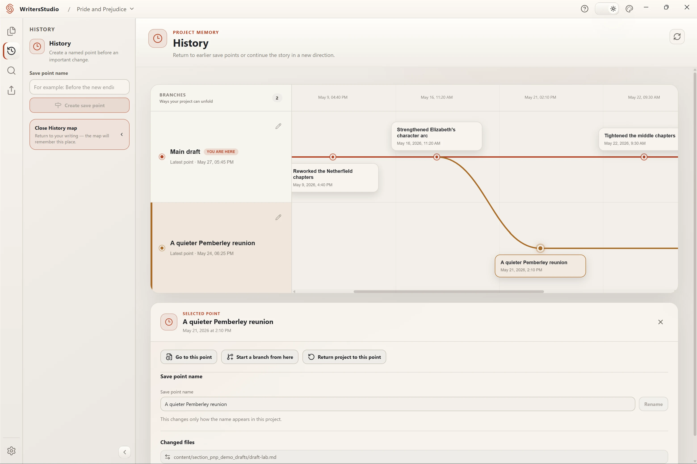
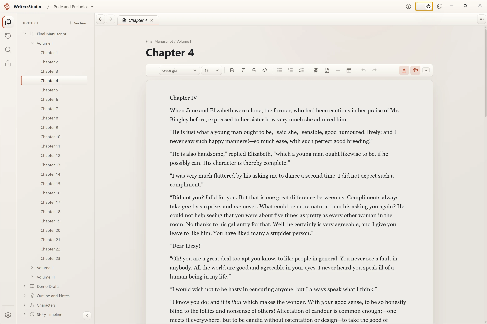
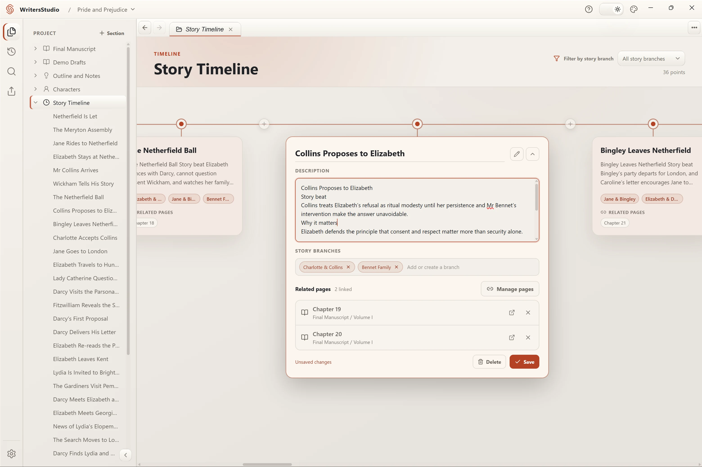
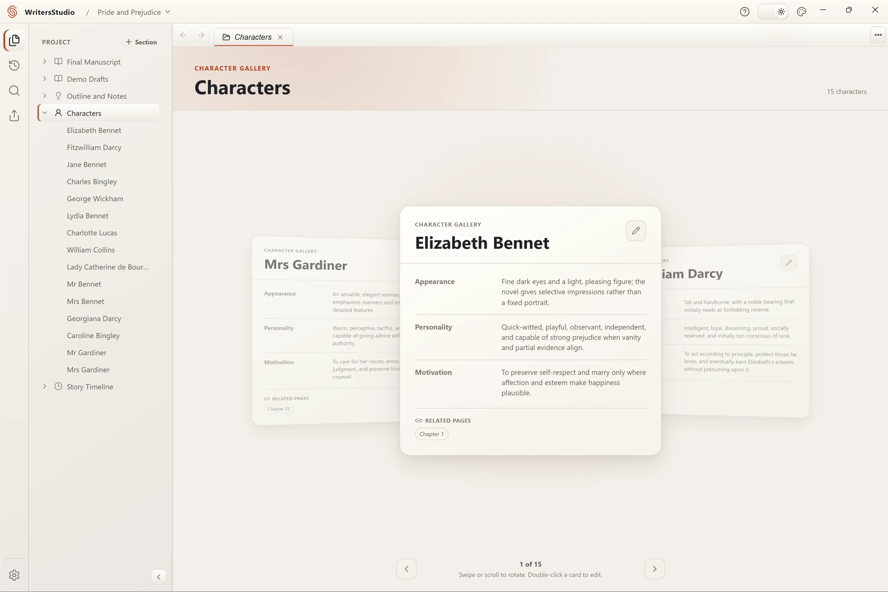

# WritersStudio

### Build the world. Shape the story. Keep every word yours.

A calm, local-first desktop studio for novels and long-form fiction.

**[Download the latest release](../../releases/latest)** · [View all releases](../../releases) · [Share feedback](../../issues/new)

## Every draft stays within reach

WritersStudio keeps a local History for every new project. Create named save
points, browse earlier versions, preview the past without disturbing the current
draft, and continue from any point on a separate story branch.

Git provides the foundation under the hood; WritersStudio presents it as a
writing tool. No command line, account, remote repository, or network connection
is required.

  <picture>
    <source media="(prefers-color-scheme: dark)" srcset="./assets/screenshots/writersstudio-history-dark.webp" />
    
  </picture>

Illustrative demo. This revision history was created in WritersStudio for the sample project; it is not an authentic record of Jane Austen's work on <em>Pride and Prejudice</em>.

## One place for the entire story

WritersStudio brings your manuscript, structure, characters, timeline, notes, and revision history into one focused workspace. It gives a large story room to grow without turning the writing process into project management.

| Write naturally                                                                                      | Organize without friction                                                                                                    |
| ---------------------------------------------------------------------------------------------------- | ---------------------------------------------------------------------------------------------------------------------------- |
| **Visual Markdown editor** Format prose directly—without writing markup by hand.                  | **Flexible project tree** Arrange chapters, scenes, notes, and custom sections around your process.                       |
| **Tabs and split views** Keep a scene beside its notes, character, or timeline while you write.   | **Project-wide search and replace** Find text across the whole project, with case-sensitive and regular-expression modes. |
| **Character profiles** Build reusable profiles with custom fields and links to related documents. | **Visual timeline** See events in story order and filter them by narrative thread.                                        |

  <picture>
    <source media="(prefers-color-scheme: dark)" srcset="./assets/screenshots/writersstudio-manuscript-dark.webp" />
    
  </picture>

## Your manuscript stays yours

WritersStudio is local-first by design:

- Your projects live in folders you choose on your own computer.
- Manuscript content is stored in portable Markdown and structured project files.
- Writing, editing, search, export, and History work offline.
- No account is required to create or open a project.
- Optional usage analytics requires your consent and never includes manuscript content.
- Updating or uninstalling WritersStudio does not remove your project folders.

Export selected sections to **DOCX** for further editing or **PDF** for sharing and review. You can also create a portable ZIP copy of a project whenever you want an independent backup.

> [!IMPORTANT]
> Local History protects your revisions, but it is not a replacement for a backup on another drive or service. Keep an independent copy of work you cannot afford to lose—especially while WritersStudio is in beta.

## See the story beyond the page

Open a character beside the manuscript, trace events across the visual timeline, or keep notes next to the scene that needs them. The workspace adapts to the way you think instead of forcing every part of a novel into one document.

<table>
  <tr>
    <td width="50%" align="center">
      <picture>
        <source media="(prefers-color-scheme: dark)" srcset="./assets/screenshots/writersstudio-timeline-dark.webp" />
        
      </picture>
    </td>
    <td width="50%" align="center">
      <picture>
        <source media="(prefers-color-scheme: dark)" srcset="./assets/screenshots/writersstudio-characters-dark.webp" />
        
      </picture>
    </td>
  </tr>
  <tr>
    <td align="center">Trace events, story branches, and related manuscript pages.</td>
    <td align="center">Keep character details, motivations, and relationships close at hand.</td>
  </tr>
</table>

## Explore a complete sample project

The standalone sample repository contains a ready-to-open WritersStudio
edition of Jane Austen's _Pride and Prejudice_: the complete 61-chapter novel
in three volumes, plus modern demo drafts, outlines, 15 character profiles, a
36-event story timeline, and an illustrative version history.

**[Get the Pride and Prejudice sample on GitHub](https://github.com/TrinkieYinkie/WritersStudio_sample_project)**

Install WritersStudio before opening the sample. Clone the sample repository
to keep its Git-backed version history; GitHub's Download ZIP action provides
the project files without `.git` and therefore without that history.

The novel is public domain. Supplemental planning material and the sample
history were created for this demonstration and are clearly separated from
Austen's text. The sample repository documents the exact source provenance.

## Download WritersStudio

WritersStudio is in **early access**. The current **Windows beta** is distributed
through GitHub Releases and has no digital signature, so Windows may show an unknown-publisher or SmartScreen warning. Download builds only from this official repository.

The **macOS version is in development** and is not available for download yet.

1. Open the **[latest release](../../releases/latest)**.
2. Download `WritersStudio-<version>-Setup.exe` from **Assets**.
3. Run the installer and start a new project—or open an existing WritersStudio project.

To update manually, install the newer version over the existing application. Your projects and application settings remain in place.

<strong>Language support</strong>

The WritersStudio interface is complete in **English**, **Russian**, and **Spanish**.

Preview translations with an explicit English fallback are available for German, French, Brazilian Portuguese, Italian, Polish, Ukrainian, Turkish, Japanese, Korean, and Simplified Chinese.

## What comes next

The first chapter of WritersStudio is deliberately local. Optional **WritersStudio Cloud** is planned and is not available yet. It may later provide multi-device sync and off-device backup while keeping the local-first foundation intact. The desktop application will remain free.

## Frequently asked questions

<strong>Is WritersStudio free?</strong>

Yes. WritersStudio Local is free to download and use, and it will remain free.

<strong>Do I need an account or an internet connection?</strong>

No. An account is not required, and the core writing experience works offline. Internet access is used for downloads, update checks, and optional usage analytics if you enable it. Manuscripts remain on your computer.

<strong>Does WritersStudio upload my writing?</strong>

No. The current local application keeps project content on your computer and does not include a Cloud service.

<strong>Is WritersStudio open source?</strong>

No. This public repository hosts official installers, release notes, and product support; it does not contain or license the WritersStudio source code.

<strong>Which platforms are supported?</strong>

The early-access beta is available for Windows. The Windows build is not digitally signed yet. macOS support is in development.

## Feedback and beta notes

WritersStudio is actively evolving. If something breaks, feels confusing, or gets in the way of writing, please **[open an issue](../../issues/new)**. Include the WritersStudio version and Windows version when reporting a bug, but never attach private manuscript content or unredacted local paths to a public issue.

This repository is the official home for public WritersStudio releases. It contains distributable application files and release information, not the application source code.

 

**Made for stories too large for a single document.**

